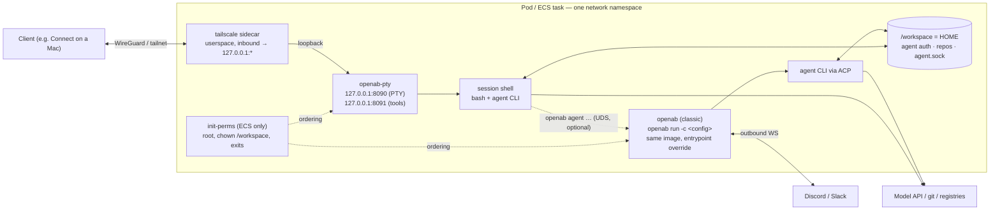

# Colocating classic openab with openab-pty

One deployment unit that runs **both** halves of the loop over the same
`/workspace`: the `openab` broker (chat-driven agent, or a headless
`[control_plane]`) and the `openab-pty` terminal, so the human in the PTY and
the agent work on one tree. This is ADR profile 3 — the adjacency case — from
[`docs/adr/openab-pty-runtime.md`](https://github.com/openabdev/openab/blob/main/docs/adr/openab-pty-runtime.md).

The manifests below are the reviewed source of truth for this shape: a client
such as OpenAB Connect renders them without hand-editing, and
[`../tests/test_colocated_openab.py`](../tests/test_colocated_openab.py) parses
every yaml block on this page and pins the properties that matter, so the
document cannot drift away from what it claims.



Everything inside the box shares the network namespace and the workspace
volume; on ECS it also shares the task role. Read the
[trust model](#trust-model) before deploying — the shared tree and the shared
loopback are the point, and they are also the attack surface.

## The image question, settled once

**Both containers run the same image.** `openab-pty`'s Dockerfile is
`FROM ghcr.io/openabdev/openab@<digest>`, so the `openab` binary, the agent
CLI, and uid 1000 are already inside it. Classic openab runs from the
openab-pty image with its entrypoint overridden:

```
tini -- openab run -c <config-ref>
```

That buys three things the two-image form cannot guarantee:

- **One pull.** No second ~700 MB image beside the first.
- **One CLI version.** Broker and terminal can never disagree about which
  agent CLI they carry — the whole reason for basing on the OAB image.
- **One uid/HOME shape.** Both processes run as uid 1000 with
  `HOME=/workspace`, which is what makes the terminal land inside the agent's
  actual environment rather than a lookalike.

### Applying it to `deploy/ecs/kiro-with-pty.yaml`

That manifest predates this shape: its `openab` container pulls
`ghcr.io/openabdev/openab:pre-beta-kiro` while its `openab-pty` container pulls
`ghcr.io/openabdev/openab-pty:pre-beta-kiro`. The two tags are interchangeable
for the broker — the pty image *is* the openab image plus a static binary and
an entrypoint — so the colocated form is to run the broker from the pty image
and override the entrypoint. The `openab` container stanza becomes:

```yaml
    - name: openab
      image: ghcr.io/openabdev/openab-pty:pre-beta-kiro   # was openab:pre-beta-kiro
      essential: true
      user: "1000"
      entryPoint: ["tini", "--"]
      command: ["openab", "run", "-c", "s3://<bucket>/<agent>/config.toml"]
      dependsOn:
        - containerName: init-perms
          condition: SUCCESS
      env:
        HOME: /workspace
        RUST_LOG: info
        OPENAB_BACKEND_AGENT: kiro
        OPENAB_AGENT_NAME: kiro-with-pty
      secrets:
        DISCORD_BOT_TOKEN: "arn:aws:secretsmanager:us-east-1:123456789012:secret:openab/b0-XXXXXX:DISCORD_BOT_TOKEN::"
      mountPoints:
        /workspace: workspace
        /tmp: tmp
      logGroup: /ecs/kiro-with-pty
```

Everything else in `kiro-with-pty.yaml` — the init-perms ordering, the
tailscale command, the pty hardening — is unchanged.

## Kubernetes — variant C (one pod, three containers)

The smallest change from `deploy/k8s/pod-tailscale.yaml`: `openab` joins as a
third container next to `tailscale` and `openab-pty`. This is the canonical
variant-C manifest — the content a `deploy/k8s/pod-with-openab.yaml` would
carry — embedded here so the test suite keeps it honest, and so a client can
render it verbatim rather than hand-editing.

```yaml
# openab-pty + classic openab in one pod — the colocated adjacency shape.
#
# One network namespace, one /workspace, one tailnet identity. The broker and
# the terminal run from the SAME image; the broker only overrides the
# entrypoint. Platform tokens are injected into the openab container alone;
# PTY_ADMIN_HASH reaches openab-pty alone; the tailscale sidecar holds only its
# own auth key.
apiVersion: v1
kind: Pod
metadata:
  name: openab-with-pty
  namespace: openab-pty
  labels:
    app: openab-with-pty
spec:
  automountServiceAccountToken: false
  restartPolicy: Never
  securityContext:
    runAsNonRoot: true
    runAsUser: 1000
    runAsGroup: 1000
    fsGroup: 1000
    seccompProfile:
      type: RuntimeDefault

  containers:
    # ---------------------------------------------------------------- tailscale
    # Identical to pod-tailscale.yaml: userspace networking, inbound tailnet
    # TCP forwarded to pod loopback. Note what that means here — see the trust
    # model below: the sidecar forwards to *every* loopback port, including any
    # listener the broker opens.
    - name: tailscale
      image: tailscale/tailscale:stable
      imagePullPolicy: IfNotPresent
      env:
        - name: TS_AUTHKEY
          valueFrom:
            secretKeyRef: { name: openab-pty-tailscale, key: authkey }
        - name: TS_USERSPACE
          value: "true"
        - name: TS_HOSTNAME
          value: "openab-with-pty"
        - name: TS_STATE_DIR
          value: /tmp/tsstate
        - name: TS_KUBE_SECRET
          value: ""
        - name: TS_EXTRA_ARGS
          value: "--accept-dns=false"
      securityContext:
        allowPrivilegeEscalation: false
        readOnlyRootFilesystem: true
        capabilities:
          drop: ["ALL"]
      resources:
        requests: { memory: 64Mi, cpu: 50m }
        limits: { memory: 192Mi, cpu: 500m }
      volumeMounts:
        - name: ts-state
          mountPath: /tmp/tsstate
        - name: ts-tmp
          mountPath: /tmp

    # --------------------------------------------------------------- openab-pty
    # Identical to pod-tailscale.yaml.
    - name: openab-pty
      image: ghcr.io/openabdev/openab-pty:pre-beta-kiro
      imagePullPolicy: IfNotPresent
      env:
        - name: PTY_ADMIN_HASH
          valueFrom:
            secretKeyRef: { name: openab-pty, key: admin-hash }
        - name: HOME
          value: /workspace
        - name: PTY_MAX_SESSIONS
          value: "3"
        - name: PTY_ABSOLUTE_TTL
          value: 12h
        - name: PTY_IDLE_TTL
          value: 8h
        - name: PTY_TOOLS_LISTEN
          value: 127.0.0.1:8091
      securityContext:
        allowPrivilegeEscalation: false
        readOnlyRootFilesystem: true
        capabilities:
          drop: ["ALL"]
      resources:
        requests: { memory: 128Mi, cpu: 100m }
        limits: { memory: 512Mi, cpu: "1" }
      volumeMounts:
        - name: workspace
          mountPath: /workspace
        - name: runtime-state
          mountPath: /run/openab-pty
        - name: tmp
          mountPath: /tmp

    # ------------------------------------------------------------------- openab
    # The broker, from the same image — the entrypoint is overridden, not the
    # image. Every write it makes lands on a mounted volume (HOME=/workspace,
    # /tmp), which is what lets it carry the same readOnlyRootFilesystem
    # hardening as the terminal; see the verification note below.
    #
    # OPENAB_ACP_ENABLED stays unset: the sidecar forwards inbound tailnet TCP
    # to every loopback port, so an unauthenticated ACP listener on :8080 would
    # be tailnet-reachable. If you enable ACP or the MCP facade, put an auth
    # key in front of it — see the trust model.
    - name: openab
      image: ghcr.io/openabdev/openab-pty:pre-beta-kiro
      imagePullPolicy: IfNotPresent
      command: ["tini", "--"]
      args: ["openab", "run", "-c", "s3://<bucket>/<agent>/config.toml"]
      env:
        - name: HOME
          value: /workspace
        - name: RUST_LOG
          value: info
        - name: OPENAB_BACKEND_AGENT
          value: kiro
        - name: OPENAB_AGENT_NAME
          value: openab-with-pty
        # Platform tokens reach ONLY this container. The broker resolves
        # ${VAR} references in its config from its own environment — which is
        # exactly why they must never be expressed as PTY_FORWARD_*: those are
        # copied into every session shell.
        - name: DISCORD_BOT_TOKEN
          valueFrom:
            secretKeyRef: { name: openab-tokens, key: discord-bot-token }
      securityContext:
        allowPrivilegeEscalation: false
        readOnlyRootFilesystem: true
        capabilities:
          drop: ["ALL"]
      resources:
        requests: { memory: 256Mi, cpu: 100m }
        limits: { memory: 1Gi, cpu: "1" }
      volumeMounts:
        - name: workspace
          mountPath: /workspace
        - name: tmp
          mountPath: /tmp

  volumes:
    # An emptyDir makes the whole shape ephemeral — fine for dogfooding. For
    # anything real, point this at a PVC so the workspace survives pod
    # replacement; the broker's state and the repos live here.
    - name: workspace
      emptyDir: {}
    - name: runtime-state
      emptyDir: { medium: Memory, sizeLimit: 16Mi }
    - name: tmp
      emptyDir: { sizeLimit: 512Mi }
    - name: ts-state
      emptyDir: {}
    - name: ts-tmp
      emptyDir: {}
```

And the secret that only the broker sees:

```bash
kubectl -n openab-pty create secret generic openab-tokens \
  --from-literal=discord-bot-token='<platform token>'
```

`fsGroup: 1000` makes the workspace writable for uid 1000, so no init
container is needed on k8s (that machinery exists for Fargate, which has no
fsGroup equivalent).

## Kubernetes — variant B (two pods, shared RWO volume)

For when the task-role problem on ECS has its k8s analogue — when you want a
NetworkPolicy that selects each pod independently, or a different
service-account posture per container. Two pods pinned to one node share the
read-write-once workspace PVC; the broker pod needs no tailnet sidecar at all,
which removes the "every loopback port is tailnet-reachable" concern for the
broker entirely:

```yaml
# Condensed variant-B sketch — the broker pod. The terminal pod is
# pod-tailscale.yaml unchanged except the workspace volume switches from
# emptyDir to the shared PVC; it keeps its `app: openab-pty` label, which is
# what this pod's affinity selects.
apiVersion: v1
kind: Pod
metadata:
  name: openab-broker
  namespace: openab-pty
  labels:
    app: openab-broker
spec:
  automountServiceAccountToken: false
  restartPolicy: Never
  securityContext:
    runAsNonRoot: true
    runAsUser: 1000
    runAsGroup: 1000
    fsGroup: 1000
    seccompProfile:
      type: RuntimeDefault
  # Pin to whichever node the terminal pod landed on: a ReadWriteOnce PVC can
  # only attach to one node at a time. The terminal pod carries no affinity of
  # its own — the broker follows it, one direction only.
  affinity:
    podAffinity:
      requiredDuringSchedulingIgnoredDuringExecution:
        - labelSelector:
            matchLabels: { app: openab-pty }
          topologyKey: kubernetes.io/hostname
  containers:
    - name: openab
      image: ghcr.io/openabdev/openab-pty:pre-beta-kiro
      command: ["tini", "--"]
      args: ["openab", "run", "-c", "s3://<bucket>/<agent>/config.toml"]
      env:
        - name: HOME
          value: /workspace
        - name: DISCORD_BOT_TOKEN
          valueFrom:
            secretKeyRef: { name: openab-tokens, key: discord-bot-token }
      securityContext:
        allowPrivilegeEscalation: false
        readOnlyRootFilesystem: true
        capabilities:
          drop: ["ALL"]
      volumeMounts:
        - name: workspace
          mountPath: /workspace
        - name: tmp
          mountPath: /tmp
  volumes:
    - name: workspace
      persistentVolumeClaim:
        claimName: openab-workspace   # ReadWriteOnce
    - name: tmp
      emptyDir: {}
```

Variant B is the full-isolation option; variant C is the smallest diff. ECS
has no variant B — ephemeral storage is task-scoped — so on ECS the colocated
task is the only option and the task-role caveat below is unavoidable.

## Config path and secrets

The broker's config is a remote document, not a mounted file:

```
openab run -c s3://<bucket>/<agent>/config.toml     # or https://
```

Platform tokens stay out of the config — the config references them as
`${VAR}` and the broker resolves those from its own environment. The rule that
keeps this deployment honest:

- Tokens are injected **only into the `openab` container**, as `secretKeyRef`
  env entries (k8s) or `secrets:` (ecsctl).
- **Never** express a platform token as `PTY_FORWARD_*`. Anything under that
  prefix is copied into every session shell's environment — a Discord token
  would land in the terminal's trust zone.
- `PTY_ADMIN_HASH` is the mirror image: it is a secret on `openab-pty` and
  nowhere else. The broker has no business holding the terminal's verifier.

## `readOnlyRootFilesystem` on the broker

The terminal container runs hardened — read-only root filesystem, all
capabilities dropped — and the manifest above keeps the broker at the same
level. That is justified by where the broker writes rather than assumed:

- Its config is fetched remotely (`s3://`/`https://`) — no config file needs a
  writable path.
- `HOME=/workspace`, and the workspace is a mounted volume — so
  `~/.openab/run/` (state, the agent UDS) lands on writable storage.
- `/tmp` is a mounted `emptyDir`.

No filesystem path the broker needs is outside those two mounts, so a
read-only rootfs does not starve it. If a future broker version writes
elsewhere it will fail loudly with `EROFS` on startup — drop
`readOnlyRootFilesystem` on the `openab` container to confirm, then file it:
a broker that writes outside HOME is a bug worth knowing about, not a shape to
accommodate quietly. (Stated as static analysis — the image's entrypoint and
the mount layout — not a live-boot claim; verify on first deploy like
everything else on this page.)

## Trust model

These are not disclaimers to skim. Each is a property of the shape itself.

### `/workspace` is one trust zone

The session shell can read the agent's OAuth store, `.env` files, and git
credentials — and the reverse: either side can plant hooks the other later
executes (the ADR's "Coexistence with ACP" section). Deploy this only where
you would hand the agent's filesystem access to whoever holds the PTY admin
credential, and vice versa.

### The sidecar exposes every loopback port

Userspace `tailscaled` forwards inbound tailnet TCP to **all** pod-loopback
ports — measured in the #37 spike, and it is why `PTY_TOOLS_LISTEN` needed no
`serve` config. The consequence for this shape: if the broker enables ACP
(`OPENAB_ACP_ENABLED`, default `:8080`) or its MCP facade, those listeners
become tailnet-reachable too. They must stay off — the manifest leaves them
unset — or sit behind an auth key. There is no third option; loopback is not
a boundary once a sidecar shares the namespace.

### The ECS task role is task-wide

The broker needs a role (S3 config and state). But the credentials endpoint is
reachable from every container in the task — a session shell in the `openab-pty`
container can query `169.254.170.2` for the task's credentials too. More
subtly, a session process runs as the same uid as the broker, so it can read
`AWS_CONTAINER_CREDENTIALS_RELATIVE_URI` out of the broker's
`/proc/<pid>/environ` to find the endpoint. This contradicts the "openab-pty
holds no AWS credentials" comment in `kiro-with-pty.yaml` — in the colocated
task, effectively, it does.

Either scope the task role so a session's reach is acceptable (least-privilege
S3 paths only, nothing else), or accept it explicitly. On k8s, variant B is
the structural fix — separate pods, separate identities, a NetworkPolicy that
selects each one.

### The control socket

With `HOME=/workspace` on both sides, the broker's UDS lands at
`/workspace/.openab/run/agent.sock` — visible to the session shell. With
`[control_plane] type = "primary"` that is a feature: `openab agent spawn …`
works from the PTY, which is phase 0 of the control-plane plan. When you are
*not* running a primary control plane it is an unintended surface: set
`OPENAB_AGENT_SOCKET` to a path outside `/workspace` (for example a fresh
`emptyDir` mounted at `/run/openab`) so the socket stays out of the shared
tree.

### Concurrency

Writes to the shared tree are uncoordinated — the broker's agent and your
shell can edit the same files at the same time with no lock between them.
Give each principal its own git worktree under `/workspace` (e.g.
`/workspace/repo` for the agent, `/workspace/repo-human` for you) so merges
are a deliberate act rather than a collision.

## Sizing

Connect's ECS defaults — **1024 CPU / 2048 MB** — assume a terminal alone. The
four-container floor in `kiro-with-pty.yaml` is **2048 / 4096**, because both
the broker and the agent CLI it drives hold real resident memory. As a rule of
thumb for clients computing their own defaults:

```
cpu    = 1024 (terminal baseline) + ~512–1024 (broker + agent CLI headroom)
memory = 2048 (terminal baseline) + ~1024–2048 (broker + agent CLI)
```

i.e. roughly double the PTY-only figure, with **2048 / 4096 as the floor** —
below that the agent CLI and a real shell workload contend for memory and the
first casualty is the broker under load. A client should raise its defaults
when the "also run classic openab" option is on, not ask the operator to
discover the contention.

## Out of scope

- Merging the two processes, or PTY ↔ ACP process attach. Per the ADR the
  runtimes share files, never processes.
- Live-PTY delivery of delegations (control-plane phase 2).
- Changes to the runtime itself — this issue is the deploy artefacts, the
  verification, and these docs. A consumer such as Connect needs nothing from
  the runtime to offer this shape.
