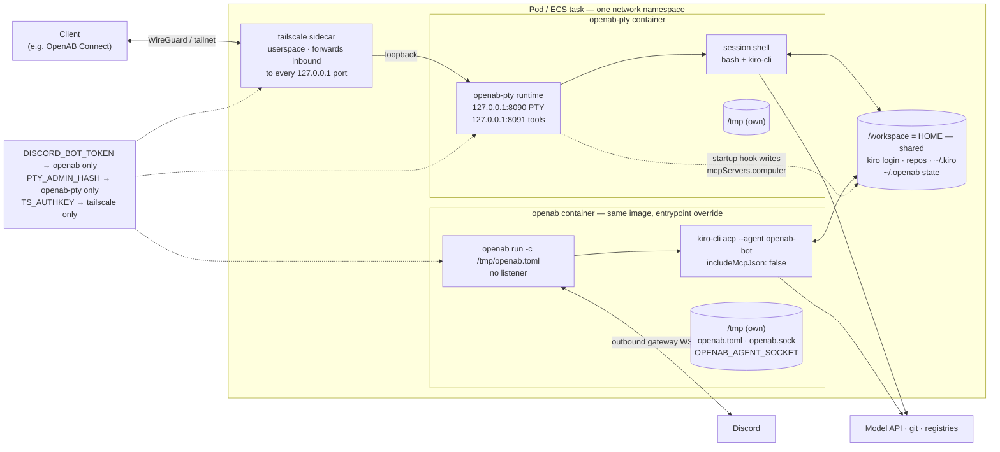

# Colocating classic openab with openab-pty

One deployment unit that runs both halves of the loop over the same
`/workspace`: a classic `openab run` broker (a Discord bot driving the agent CLI
over ACP) and the `openab-pty` terminal. The agent and the human in the PTY work
on one tree. This is ADR profile 3, the adjacency case, from
[`docs/adr/openab-pty-runtime.md`](https://github.com/openabdev/openab/blob/main/docs/adr/openab-pty-runtime.md)
in `openabdev/openab`.

The manifests are files, not snippets on this page:

| Substrate | Manifest | Shape |
|---|---|---|
| Kubernetes | [`deploy/k8s/pod-with-openab.yaml`](../deploy/k8s/pod-with-openab.yaml) | variant C: one pod, `tailscale` + `openab-pty` + `openab` |
| ECS Fargate | [`deploy/ecs/kiro-with-pty.yaml`](../deploy/ecs/kiro-with-pty.yaml) | one task, `init-perms` + `tailscale` + `openab` + `openab-pty` |

[`tests/test_colocated_manifests.py`](../tests/test_colocated_manifests.py) pins
the properties below on those files, so a client such as OpenAB Connect can
render from them and a change that breaks the shape fails CI.



What the two containers share is `/workspace` and the network namespace, and
nothing else: each has its own `/tmp`, its own secret, and its own process
tree. On ECS there is also an `init-perms` container that chowns the volumes
and exits, because Fargate has no `fsGroup`. Read the
[trust model](#trust-model) before deploying. The shared tree is the point of
the shape, and it is also its attack surface.

## What was measured

On p1 (k3s v1.36.2) with `openab-pty:pre-beta-kiro`, openab 0.10.0 and kiro-cli
2.13.0, running `pod-with-openab.yaml` without the tailscale sidecar and with a
real test bot:

- **`openab run` works under `readOnlyRootFilesystem` with all capabilities
  dropped.** It needs nothing writable outside `/workspace` and its own `/tmp`.
  It writes `/workspace/.openab/{cache/threads.json,reminders.json}`,
  `/tmp/openab.toml` and its control socket `/tmp/openab.sock`. kiro-cli writes
  under `/workspace/.local/share/kiro-cli` and `/workspace/.kiro`. Nothing hit
  `EROFS`.
- **A Discord round trip works across the containers.** A mention asking the bot
  to create `/workspace/hello-62.txt` produced the file, and the file was
  readable from the `openab-pty` container.
- **A rejected token exits 1.** The bot needs a restart path, described under
  [restarts](#restarts).
- **The tools plane collides with the bot unless the bot uses its own agent.**
  See [the tools plane](#the-tools-plane-and-the-bot).

The ECS manifest was checked structurally and has not been deployed. The
tailscale container is unchanged from `pod-tailscale.yaml`.

## One image for both sides

The openab-pty image is `FROM ghcr.io/openabdev/openab@<digest>`, so the
`openab` binary, the agent CLI, `tini` and uid 1000 are already in it. The
broker runs from the openab-pty image with the entrypoint overridden. That
gives three guarantees:

- **One pull** instead of a second ~700 MB image.
- **One CLI version.** The broker and the terminal cannot disagree about which
  agent CLI they carry.
- **One uid and HOME.** Both run as uid 1000 with `HOME=/workspace`, so the
  terminal opens in the agent's actual environment.

On ECS the `init-perms` container uses the same image for the same reason. Pin
every container to the same immutable `<variant>-<sha>` tag when you need to
reproduce a deployment. A moving tag can resolve to different digests on
different nodes. On p1 the cached `pre-beta-kiro` turned out to predate the
startup hook.

## Config and secrets

Both manifests pass the bot's config as a **non-secret** environment variable,
`OPENAB_CONFIG_TOML`. The broker's script writes it to its own `/tmp` and runs
`openab run -c /tmp/openab.toml`. The token is not in the variable. The config
refers to it as `${DISCORD_BOT_TOKEN}`, and openab expands the reference from
its own environment:

```toml
[discord]
bot_token = "${DISCORD_BOT_TOKEN}"
allowed_channels = ["<channel id>"]

[agent]
command = "kiro-cli"
args = ["acp", "--trust-all-tools", "--agent", "openab-bot"]
working_dir = "/workspace"
```

A remote config works as well: `openab run -c s3://<bucket>/<key>` or
`-c https://…`. An `s3://` config needs a task role on ECS; see
[the task role](#the-ecs-task-role) for what that implies here.

The rules that keep secrets in the right place:

- **`DISCORD_BOT_TOKEN` is injected into the `openab` container only**, as a
  `secretKeyRef` (k8s) or a `secrets:` entry (ecsctl).
- **Never pass a platform token as `PTY_FORWARD_*`.** Anything under that
  prefix is copied into every session shell's environment.
- **`PTY_ADMIN_HASH` goes to `openab-pty` only.**
- **`allowed_channels` must contain the channel's ID.** A message from any
  other channel is dropped silently: no reaction and no log line. That looks
  exactly like a broken bot.

## The tools plane and the bot

When `PTY_TOOLS_LISTEN` is set, the openab-pty startup hook writes
`mcpServers.computer` (`http://127.0.0.1:8091/mcp`, `Bearer
${OPENAB_TOOLS_MCP_TOKEN}`) into `~/.kiro/settings/mcp.json`. HOME is shared,
so the bot's kiro-cli reads that file too. The bearer token exists only in a PTY
session's environment, so the bot's requests get a 401. The measured result
was two `server_init_failure` notifications on every bot session.

The hook cannot avoid this on its side. The runtime clears its environment
before running it, so it cannot tell that a broker is present, and skipping the
entry would take the tools away from the terminal. The broker opts out instead:
its script writes `~/.kiro/agents/openab-bot.json` with `"includeMcpJson":
false` and runs `kiro-cli acp --agent openab-bot`.

| Bot's kiro agent | `server_init_failure` per session |
|---|---|
| default agent | 2 |
| custom agent, `includeMcpJson: true` | 2 |
| custom agent, field absent | 0 |
| custom agent, `includeMcpJson: false` | 0 |

The manifests set `false` explicitly, so a change of kiro's default cannot
bring the failures back. Steering survives the switch: with a codeword in
`/workspace/.kiro/steering/`, the default agent and `openab-bot` both answered
it.

## Restarts

A bad or reset Discord token makes `openab run` exit 1. That must restart the
bot. It must not take down the terminal, and it must not leave the bot dead
while the terminal keeps running.

- **k8s:** `restartPolicy: OnFailure` (`pod-tailscale.yaml` uses `Never`). The
  policy is pod-wide, so a crashed runtime or sidecar now restarts in place too.
  Measured: the `openab` container restarted three times in 60 s while
  `openab-pty` stayed up with zero restarts.
- **ECS:** the `openab` container is `essential: false`, so its exit does not
  stop the task. ECS never restarts a non-essential container, so its script
  loops `openab run` with a backoff of 5 s, growing to 30 s. Replace the loop
  with a container `restartPolicy` once ecsctl can express one
  ([oablab/ecsctl#60](https://github.com/oablab/ecsctl/issues/60)).

The broker script scopes `umask 077` to the config write. kiro-cli inherits the
shell's umask, so a script-wide `umask 077` made every file the bot created
`0600` (measured).

## Trust model

Each of these is a property of the shape itself. None of them is a bug that a
later fix will remove.

### `/workspace` is one trust zone, in both directions

- **Shell to bot.** A session shell can write `~/.kiro` (agents, MCP config,
  steering, hooks) and anything else the bot's kiro-cli loads, so the next bot
  session executes it inside the `openab` container. That container is the
  exposed one. openab is dumpable and has the same uid as everything else, so
  code running there can read `/proc/<openab pid>/environ`, which holds the
  Discord token and, on ECS, any task-role credentials URI.
- **Bot to shell.** A Discord prompt injection can make the agent write files a
  session later runs: shell rc files, git hooks, `.env`.
- **What does not leak directly:** the openab-pty runtime sets itself
  non-dumpable and gives sessions an allowlisted environment, so a shell cannot
  read the runtime's environment or `PTY_ADMIN_HASH`. On Fargate each container
  has its own PID namespace, so a shell cannot read the broker's `/proc` without
  going through the bot. On k8s the containers do not share a PID namespace
  either, unless `shareProcessNamespace` is set, which these manifests do not
  do.

Deploy this only where everyone who can open a terminal session may also hold
the bot's token, and where everyone who can prompt the bot may also have a
shell.

### The sidecar exposes every loopback port

Userspace `tailscaled` forwards inbound tailnet TCP to every port on the pod's
loopback, not only to `:8090` and `:8091`. This was measured in the #37 spike.
The broker therefore runs with **no listener**: no `[mcp]` section and
`OPENAB_ACP_ENABLED` unset. If you enable ACP (`:8080`) or the MCP facade, that
port becomes tailnet-reachable, so put an auth key on it
(`OPENAB_ACP_AUTH_KEY`). Loopback stops being a boundary once a sidecar shares
the namespace.

### The ECS task role

A task role is task-wide. Fargate gives every container the credentials
endpoint, and the bot path above gives a session a way to reach it.
`kiro-with-pty.yaml` therefore has **no task role**: a Discord bot configured
from an environment variable needs none, because its secrets are resolved by
the execution role at launch. If you add a task role, for an `s3://` config or
S3 state, treat every terminal session as holding it and scope it to match. On
k8s, [variant B](#variant-b-two-pods) gives each workload its own pod and its
own identity.

### Sockets

The broker opens its control socket at `/tmp/openab.sock` and, with
`[control_plane]`, the agent socket at `OPENAB_AGENT_SOCKET`. Both manifests put
both sockets in the broker's own `/tmp`, out of reach of a session. If you
deliberately want `openab agent …` to work from the terminal (control-plane
phase 0, `type = "primary"`), point `OPENAB_AGENT_SOCKET` into `/workspace`. That
grants every session the ability to start delegations.

### Concurrency

The agent and the shell write to the shared tree with no coordination. Give
each one its own git worktree, for example `/workspace/repo` for the bot and
`/workspace/repo-human` for you, so that combining their work is a deliberate
merge rather than a collision.

## Sizing

Connect's PTY-only ECS default is 1024 CPU / 2048 MB. The broker adds itself
plus one `kiro-cli acp` process tree per pooled session, up to
`[pool].max_sessions`:

```
memory ≈ terminal baseline + broker + max_sessions × (one kiro-cli acp session)
```

`kiro-with-pty.yaml` uses **2048 CPU / 4096 MB** with `max_sessions = 2`, and
that is the floor to raise a client's default to when the bot is enabled. On
k8s, `pod-with-openab.yaml` gives the `openab` container a 2 GiB limit for the
same two sessions. The per-session figure has not been measured. Raise
`max_sessions` together with the limit, never alone.

## Variant B: two pods

Variant B is the full-isolation alternative on k8s. It runs two pods that share
a ReadWriteOnce workspace PVC and are pinned to one node. The broker pod has no
tailnet sidecar, so the loopback exposure above does not apply to it. A
NetworkPolicy can select each pod separately, and each pod gets its own service
account. ECS has no variant B, because task storage is task-scoped.

This is a sketch, not a shipped manifest. The terminal pod is
`pod-tailscale.yaml` with its `workspace` volume switched to the PVC. The broker
pod follows the terminal pod, and never the reverse: two pods with mutual
required affinity would block each other from scheduling.

```yaml
apiVersion: v1
kind: Pod
metadata:
  name: openab-broker
  namespace: openab-pty
  labels:
    app: openab-broker
spec:
  automountServiceAccountToken: false
  restartPolicy: OnFailure
  securityContext:
    runAsNonRoot: true
    runAsUser: 1000
    runAsGroup: 1000
    fsGroup: 1000
    seccompProfile: { type: RuntimeDefault }
  affinity:
    podAffinity:
      requiredDuringSchedulingIgnoredDuringExecution:
        - labelSelector:
            matchLabels: { app: openab-pty }   # pod-tailscale.yaml's label
          topologyKey: kubernetes.io/hostname
  containers:
    - name: openab
      image: ghcr.io/openabdev/openab-pty:pre-beta-kiro   # same as the terminal
      # command, args and env: as the openab container in pod-with-openab.yaml
      securityContext:
        allowPrivilegeEscalation: false
        readOnlyRootFilesystem: true
        capabilities: { drop: ["ALL"] }
      volumeMounts:
        - { name: workspace, mountPath: /workspace }
        - { name: tmp, mountPath: /tmp }
  volumes:
    - name: workspace
      persistentVolumeClaim: { claimName: openab-workspace }   # ReadWriteOnce
    - name: tmp
      emptyDir: {}
```

The `/workspace` trust zone is unchanged in variant B: the files are still
shared.

## Out of scope

- **Merging the two processes, or attaching the PTY to an ACP process.** Per
  the ADR, the runtimes share files, never processes.
- **Live-PTY delivery of control-plane delegations** (phase 2).
- **Runtime changes.** Nothing here required one; a client offering this shape
  needs only the manifests.

Credit: the structure of this page, the variant-B sketch and the first version
of the tests come from openabdev/openab-pty#63 by @Reese-max.
